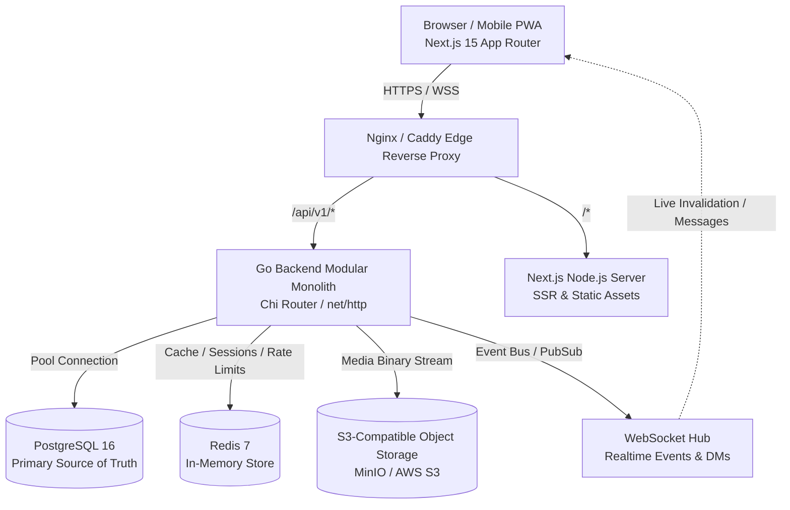

# System Architecture & Monorepo Topology

**Status:** Phase 3 Architecture Specification  
**Project:** X / Twitter Independent Full-Stack Reconstruction

---

## 1. High-Level Architecture Overview



---

## 2. Monorepo Organization

The project is structured as an explicit, scalable monorepo separating frontend, backend services, database migrations, deployment infrastructure, and documentation:

```
.
├── apps/
│   └── web/                         # Next.js 15 (React 19, TypeScript, Tailwind CSS)
│       ├── public/                  # Static assets & icons
│       ├── src/
│       │   ├── app/                 # Next.js App Router (Layouts & Pages)
│       │   │   ├── (auth)/          # Login & Signup flows
│       │   │   ├── (main)/          # Core platform shell (3-column layout)
│       │   │   │   ├── home/        # For you & Following feeds
│       │   │   │   ├── explore/     # Search & Trends
│       │   │   │   ├── notifications/# Notifications feed
│       │   │   │   ├── messages/    # DM conversations
│       │   │   │   ├── bookmarks/   # Saved posts
│       │   │   │   └── [username]/  # Profile view & sub-tabs
│       │   │   │       └── status/[postId]/ # Focal post detail & thread
│       │   │   └── api/             # Next.js BFF / proxy handlers if needed
│       │   ├── components/          # Feature & UI component library
│       │   │   ├── layout/          # LeftNavRail, RightSidebar, StickyHeader
│       │   │   ├── feed/            # PostCard, FeedTimeline, InteractionBar
│       │   │   ├── composer/        # PostComposer, MediaUploader, EmojiPicker
│       │   │   ├── profile/         # ProfileHeader, FollowButton, Tabs
│       │   │   └── ui/              # shadcn/ui accessible primitives (Dialog, Dropdown, Button)
│       │   ├── hooks/               # Custom React hooks (useAuth, useFeed, useWebSocket)
│       │   ├── lib/                 # Utilities, API client (fetch wrapper), date formatters
│       │   └── types/               # TypeScript interfaces (mapped from OpenAPI contract)
│       ├── package.json
│       ├── tsconfig.json
│       └── tailwind.config.ts
├── services/
│   └── api/                         # Go Backend Service (Modular Monolith)
│       ├── cmd/
│       │   ├── server/              # Application entrypoint (main.go)
│       │   └── seeder/              # Development mock data generator
│       ├── internal/
│       │   ├── config/              # Environment-based configuration
│       │   ├── domain/              # Core domain entities & business interfaces
│       │   ├── handler/             # HTTP REST handlers (v1)
│       │   ├── middleware/          # Auth, CORS, Logger (slog), RateLimiter, Recovery
│       │   ├── repository/          # PostgreSQL data access layer (raw SQL / sqlc)
│       │   ├── service/             # Business logic orchestration (Auth, Post, Feed, Follow)
│       │   ├── realtime/            # WebSocket hub & client connection pool
│       │   └── storage/             # S3 object storage client
│       ├── go.mod
│       └── go.sum
├── deploy/
│   ├── docker/
│   │   ├── Dockerfile.web
│   │   ├── Dockerfile.api
│   │   └── docker-compose.yml       # Orchestrates Postgres, Redis, MinIO, Go API, Next.js, Nginx
│   └── nginx/
│       └── nginx.conf
├── docs/
│   ├── reverse-engineering/         # Empirical investigation reports (Phase 1)
│   ├── architecture/                # Architecture, security, scaling docs
│   ├── database/                    # Schema, ER diagram, indexing strategy
│   └── api/                         # OpenAPI 3.0 YAML specification
└── scripts/
    ├── dev.sh / dev.ps1             # Local development orchestrator
    └── test.sh / test.ps1           # Test suite runner
```
