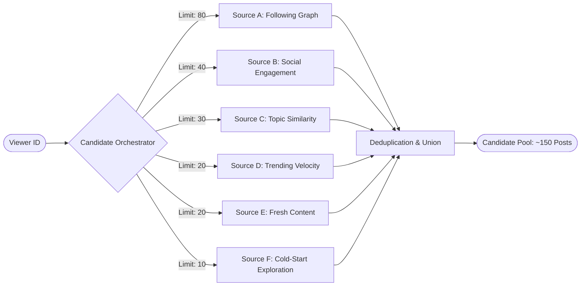

# Candidate Generation Architecture

## 1. Overview
Candidate generation is the first and most critical retrieval stage of the timeline pipeline. Rather than executing an exhaustive scan across millions of posts in PostgreSQL, the pipeline queries multiple specialized candidate sources in parallel, retrieving a bounded pool of high-potential candidates ($N \approx 100\text{–}200$) before passing them to the eligibility filter and scoring engine.

---

## 2. Specialized Candidate Sources

### Source A: Following Graph (In-Network)
- **Objective**: Retrieve the most recent posts authored or reposted by accounts the viewer explicitly follows.
- **Query Strategy**: Indexed join on `follows` table (`f.follower_id = viewer_id`).
- **Time Window**: Last 72 hours.
- **Quota Limit**: 80 candidates.
- **Characteristics**: Highest baseline trust and relevance.

### Source B: Social Engagement (2nd-Degree Graph)
- **Objective**: Discover posts engaging people in the viewer's immediate social circle.
- **Retrieval Signals**:
  1. Posts liked or reposted by mutual connections.
  2. Posts from accounts the viewer frequently replies to or DMs.
- **Time Window**: Last 48 hours.
- **Quota Limit**: 40 candidates.

### Source C: Topic Similarity (Interest Graph)
- **Objective**: Match posts against the viewer's implicit and explicit topic preferences.
- **Retrieval Signals**:
  1. Hashtags extracted from the viewer's recent positive interactions (`post_likes`, `post_bookmarks`).
  2. Explicitly followed topics in `user_topic_preferences`.
- **Query Strategy**: Indexed join on `post_hashtags` and `hashtags`.
- **Quota Limit**: 30 candidates.

### Source D: Trending & Popular (Velocity-Based)
- **Objective**: Surface viral and high-velocity conversations across the platform.
- **Key Metric**: Velocity within a rolling 6-hour window:
  $$\text{velocity} = \frac{\text{likes} + 2\cdot\text{reposts} + 3\cdot\text{replies}}{(\text{age\_hours} + 0.5)^{1.2}}$$
- **Quota Limit**: 20 candidates.

### Source E: Fresh Content (Anti-Staleness)
- **Objective**: Inject very recently created posts ($< 60\text{ minutes}$) that have not yet had time to accumulate engagement metrics.
- **Quota Limit**: 20 candidates.
- **Benefit**: Ensures live breaking events surface immediately and gives equal opportunity to newly published posts.

### Source F: Cold-Start Exploration
- **Objective**: Surface high-effort posts from creators with fewer than 500 followers.
- **Selection Criteria**: Original content (not replies), length $> 80$ characters, media attachment present.
- **Quota Limit**: 10 candidates.

---

## 3. Deduplication & Bounds Management
1. **Candidate Deduplication**: All candidate lists are merged into an ID-keyed map (`map[uuid.UUID]*Candidate`). When a post appears in multiple sources (e.g. both Following and Trending), its source flags are merged (`SourceFollowing | SourceTrending`), which positively impacts its downstream relationship and engagement scores.
2. **Quota Enforcement**: Soft limits prevent any single candidate generator from starving others or overwhelming memory. Total candidate pool size is capped at 200 items.
