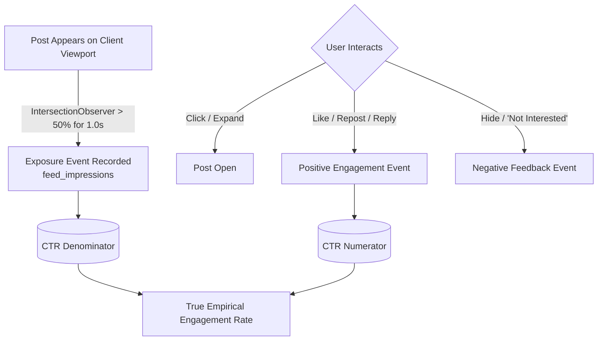

# Feed Feedback Loop & Learning Pipeline

## 1. Overview
Recommendation algorithms deteriorate quickly without continuous feedback loops. The system distinguishes between **exposure events (impressions)** and **engagement events (likes, replies, shares)** to avoid metric distortion.

---

## 2. Exposure vs. Engagement Distinction

### Critical Statistical Principle
**We never calculate Click-Through Rate (CTR) or Engagement Rate without recorded exposure denominators.** If an application assumes every post delivered in an API response was seen by the user, fast scrollers who exit after 3 posts would artificially depress engagement rates for the bottom 17 posts.
An impression is recorded only when a post is visible within the active browser viewport for at least 1,000ms.

---

## 3. Transactional Outbox Events

All interactions emit structured events into the transactional outbox:

| Event Name | Trigger Action | Payload Attributes | Downstream Consumer Action |
|---|---|---|---|
| `feed.feedback.created` | User clicks "Not Interested" or "Hide" | `{user_id, post_id, feedback_type, topic}` | Applies immediate penalty in Redis user interest vector; excludes post from subsequent feed queries |
| `post.liked` | User likes post | `{user_id, post_id, author_id, topics}` | Increments author affinity score; boosts topic preference |
| `post.unliked` | User unlikes post | `{user_id, post_id, author_id}` | Rebalances affinity counters |
| `post.reposted` | User reposts post | `{user_id, post_id, original_author_id}` | Broadcasts to follower social graphs |
| `user.followed` | User follows author | `{follower_id, following_id}` | Adds author to In-Network candidate generator; invalidates Following feed cache |
| `user.blocked` | User blocks author | `{blocker_id, blocked_id}` | Immediate hard eviction from all candidate pools |
| `user.muted` | User mutes author | `{muter_id, muted_id}` | Immediate silent suppression at eligibility filter |

---

## 4. Sampling & Retention Policy for Impressions

Storing billions of raw impressions in PostgreSQL will cause database bloat. We enforce:
1. **Probabilistic Sampling**: Exposure tracking on high-volume feeds is sampled at 10% rate ($P = 0.10$) for anonymous/unauthenticated viewers, and 100% for active testing cohorts.
2. **Automated Partitioning & TTL Retention**: `feed_impressions` rows older than 30 days are automatically pruned or rolled up into daily aggregate counters via background cleanup workers.
