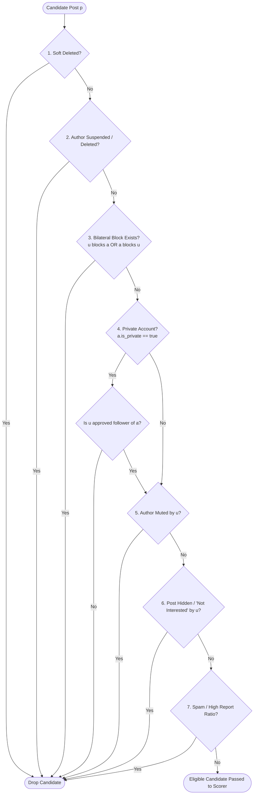

# Feed Security, Privacy & Safety Filtering Architecture

## 1. Zero-Trust Server-Side Safety Invariant
Under no circumstances does ranking or recommendation score override relational security or privacy boundaries:
$$\text{If } \neg\text{Eligible}(u, p) \implies \text{Drop}(p) \text{ before Scoring}$$

Privacy and safety checks are enforced strictly on the backend server before candidates enter the feature extraction and ranking stages. Relying on the client or frontend to hide sensitive, private, or blocked content is strictly prohibited.

---

## 2. Mandatory Eligibility Filtering Rules

Every candidate post $p$ authored by $a$ is evaluated against the following sequential filters for viewer $u$:

### Detailed Filter Specifications:
1. **Soft-Deleted Check**: `p.deleted_at IS NOT NULL` $\implies$ Dropped immediately.
2. **Account Status Check**: Author is suspended, deactivated, or soft-deleted $\implies$ Dropped.
3. **Bilateral Block Enforcement**:
   - If viewer $u$ has blocked author $a$ (`blocks(u, a)`): Dropped.
   - If author $a$ has blocked viewer $u$ (`blocks(a, u)`): Dropped.
   - *Security rationale*: A user must never see posts from someone they blocked, nor should someone access posts of a user who blocked them.
4. **Private Account Visibility Guard**:
   - If $a.\text{is\_private} == \text{true}$ and $u \neq a$:
     - Verify $u$ is an accepted follower: `EXISTS (SELECT 1 FROM follows WHERE follower_id = u AND following_id = a)`.
     - If not accepted: Dropped. Private content must never leak into "For You", search, or trending feeds.
5. **Mute Suppression**:
   - If viewer $u$ has muted author $a$ (`mutes(u, a)`): Dropped silently. The author is not notified.
6. **Negative Feedback Suppression**:
   - If viewer $u$ previously marked post $p$ as "Hide" or "Not Interested": Dropped.
7. **Spam & Integrity Filter**:
   - Posts flagged by community moderation with high valid report ratios ($> 5$ reports pending review) are withheld from discovery feeds pending moderation resolution.
