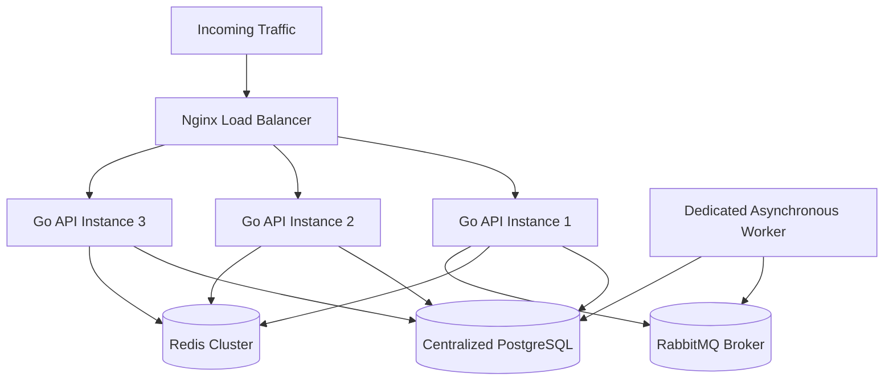

# Architecture: Horizontal Scaling Roadmap (Stage A -> Stage B -> Stage C)

## 1. Executive Summary
This document defines the evolutionary scaling path for the social media platform, transitioning from a lean single 4GB VPS to a multi-instance, multi-server distributed cluster without requiring major domain refactoring.

---

## 2. The Three Architectural Stages

```
   [STAGE A: Single 4GB VPS]
             +
             | Trigger: CPU > 80% or Traffic > 2,000 DAU
             v
   [STAGE B: Multi-Instance Scale-Out (Single Host or App Cluster)]
             +
             | Trigger: DB RAM Contention or Write I/O Saturation
             v
   [STAGE C: Dedicated Multi-VPS Tiered Topology]
```

### Stage A: Single 4GB VPS (Current Baseline)
- **Deployment**: All services containerized via Docker Compose on 1 host.
- **Topology**:
  `Client -> NGINX -> [Go API + Worker] -> [Postgres 16 + Redis 7 + RabbitMQ]`
- **Capacity**: ~500 concurrent users / 200 req/s.
- **Limitation**: Shared CPU and RAM between PostgreSQL and API.

### Stage B: Multiple Application Instances (Stateless Scale-Out)
- **Trigger**: Go API CPU utilization consistently exceeds 75% or WebSocket connection count exceeds 1,500.
- **Changes**:
  - Deploy 2–4 Go API replicas behind Nginx load balancer (`least_conn;`).
  - Session state remains fully stateless (JWT + Redis session validation).
  - WebSockets use Redis Pub/Sub for inter-instance broadcast (`realtime.Hub`).
  - Separate background worker process from API process.
- **Capacity**: ~2,500 concurrent users / 1,000 req/s.



### Stage C: Multi-VPS Dedicated Tiered Cluster
- **Trigger**: Database I/O wait exceeds 20%, or total RAM demand exceeds single host capacity (>8 GB).
- **Node Allocation**:
  1. **VPS 1: Edge Load Balancer & Nginx** (2 GB RAM, HAProxy / Nginx, SSL termination).
  2. **VPS 2 & 3: Application Server Pool** (2 x 4 GB RAM running stateless Go API instances).
  3. **VPS 4: Dedicated PostgreSQL Database** (8–16 GB RAM with NVMe SSD, tuned `shared_buffers = 4GB`).
  4. **VPS 5: Cache & Message Broker** (4 GB RAM running Redis & RabbitMQ cluster).
  5. **Object Storage & CDN**: Cloudflare R2 / AWS S3 for media assets.
- **Optional Read Replicas**: If read traffic on feeds accounts for >80% of queries, add a PostgreSQL Read Replica with streaming replication and route `GET /api/v1/feed` to the replica.

---

## 3. Transition Decision Matrix

| Metric Observed | Current Value | Target Threshold for Stage B | Target Threshold for Stage C |
| :--- | :--- | :--- | :--- |
| **API CPU Usage** | < 25% | > 75% for 15+ minutes | Scaled out horizontally across nodes |
| **Database Connections** | 10–25 active | > 65 active (near 80 limit) | Add PgBouncer connection pooler |
| **P95 Feed Latency** | 15–35 ms | > 150 ms | Add Redis feed materialization |
| **Host RAM Saturation**| ~2.4 GB used | > 3.6 GB (Swap > 200 MB) | Migrate PostgreSQL to dedicated VPS |
| **RabbitMQ Queue Depth**| < 50 messages | > 5,000 messages backlog | Scale out worker concurrency |

---

## 4. Stateless API Design Verification
The Go backend adheres strictly to the 12-factor stateless application contract:
1. **No local file storage**: Uploads stream to Cloudflare R2 or persistent Docker volume.
2. **No in-memory session caches**: Sessions validated against Redis / Postgres.
3. **Realtime event propagation**: WebSocket messages broadcast across instances via Redis channels (`ws:broadcast`).
4. **Graceful shutdown**: Intercepts `SIGTERM`, allows in-flight requests 10 seconds to drain, and shuts down database pools safely.
