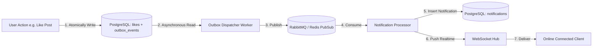

# Architecture: Realtime Notification System & Transactional Outbox

## 1. Overview
The Notification System guarantees reliable, durable event dispatching across interactions (likes, follows, reposts, mentions, and DMs) using the Transactional Outbox pattern.

## 2. Transactional Outbox Lifecycle

## 3. Notification Deduplication & Aggregation
To prevent spamming the recipient, events carry a deterministic `dedupe_key`:
- Like: `like:post:{post_id}`
- Repost: `repost:post:{post_id}`
- Follow: `follow:user:{actor_id}:target:{recipient_id}`

If an unread notification with identical `dedupe_key` exists within a 24-hour window, the existing record is updated with incremented aggregate counters rather than creating noisy individual rows.
