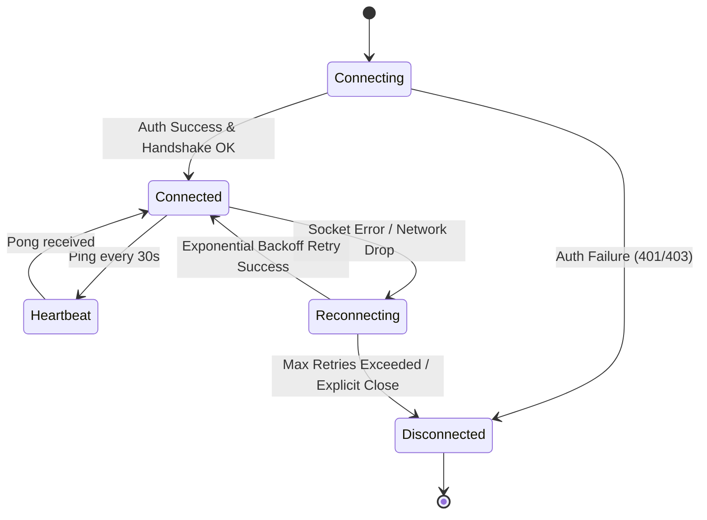
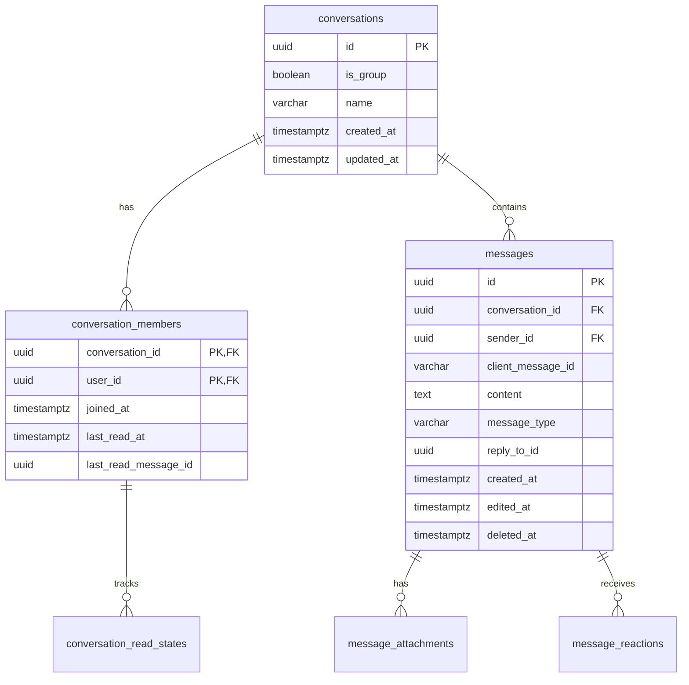

# Architecture: Realtime Direct Messaging & WebSocket Gateway

## 1. Gateway & Connection Lifecycle
The Realtime Gateway exposes a WebSocket endpoint at `/api/v1/ws` protected via session authentication (JWT or session token passed in query parameter `?token=...` or `Sec-WebSocket-Protocol`).

### Connection State Machine

## 2. Event Contracts

### Client-to-Server Events
- `conversation.subscribe`: `{ conversation_id: string }`
- `conversation.unsubscribe`: `{ conversation_id: string }`
- `typing.start`: `{ conversation_id: string }`
- `typing.stop`: `{ conversation_id: string }`
- `message.send`: `{ conversation_id: string, client_message_id: string, content: string, media_id?: string }`
- `message.read`: `{ conversation_id: string, message_id: string }`
- `ping`: `{}`

### Server-to-Client Events
- `message.created`: Full message payload with author details
- `message.status.updated`: Idempotency acknowledgement `{ client_message_id, id, status: "sent" }`
- `message.read`: `{ conversation_id, reader_id, message_id, read_at }`
- `typing.updated`: `{ conversation_id, user_id, is_typing: boolean }`
- `notification.created`: Full notification payload
- `notification.count.updated`: `{ unread_count: number }`
- `pong`: `{}`

## 3. Data Model for Messaging

