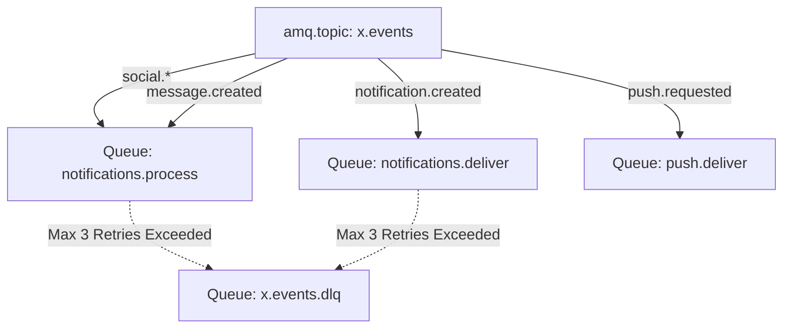

# Architecture: Redis Key Design & RabbitMQ Queue Topologies

## 1. Redis Key Namespaces, TTL & Invalidation Rules

| Key Namespace | Data Type | TTL | Purpose | Invalidation Strategy | Rebuild Strategy |
|---|---|---|---|---|---|
| `presence:user:{user_id}` | String (`"online"`) | 60 sec | Tracks online status of active sessions | Refreshed by WebSocket ping every 30s. Auto-expires upon disconnect. | Set again upon next WebSocket connection. |
| `typing:conversation:{conv_id}:user:{user_id}` | String (`"1"`) | 4 sec | Ephemeral indicator that a peer is currently typing | Cleared immediately when `typing.stop` event arrives or 4 seconds elapse. | Non-durable by design. Lost on restart without consequence. |
| `unread:user:{user_id}` | Integer | 15 min | Cached unread notification count | Incremented via atomic `INCR` on new event; invalidated on `mark-all-read`. | `SELECT COUNT(*) FROM notifications WHERE recipient_id = $1 AND is_read = false`. |
| `ratelimit:follow:{user_id}` | Integer | 60 sec | Rate limits follow actions (e.g. max 30 per min) | Standard sliding window / token bucket. | Resets on expiry. |
| `ratelimit:message:{user_id}` | Integer | 60 sec | Rate limits message spam (e.g. max 60 per min) | Sliding window. | Resets on expiry. |
| `mutuals:v:{viewer}:t:{target}` | Set/JSON | 15 min | Cached mutual connections array | Invalidated when either viewer or target follows/unfollows. | Recomputed via SQL set intersection. |

## 2. RabbitMQ Topology & Queues

- **Durable Queues & Persistent Messages:** `DeliveryMode: amqp.Persistent`.
- **At-Least-Once Delivery:** Consumers acknowledge (`ack`) only after PostgreSQL transaction succeeds.
- **Dead-Letter Queue:** Failed processing after 3 exponential backoff retries is routed to `x.events.dlq`.
