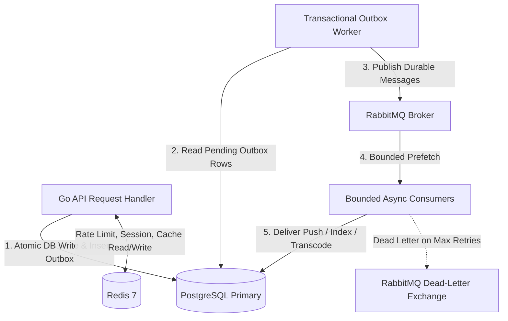

# Redis and RabbitMQ Responsibilities & Integration Architecture

This document formalizes the division of responsibilities between **Redis** (in-memory cache & ephemeral coordination) and **RabbitMQ** (durable asynchronous message broker) in the X-like architecture.

---

## 1. Core Principle: Clear Separation of Concerns

Mixing durable message persistence into an in-memory cache leads to data loss during eviction or out-of-memory crashes. In this architecture:
- **Redis is ephemeral**: If Redis restarts or evicts keys, the system remains 100% functional (albeit slower due to cache misses).
- **RabbitMQ is durable**: Events, notifications, media transcoding, and indexing jobs are acknowledged only after processing and survive process restarts.
- **PostgreSQL is the single source of truth**: No permanent state exists solely in Redis or RabbitMQ.



---

## 2. Redis Responsibilities

### 2.1 Role & Allocation
- **Container Limit**: 180 MB.
- **MaxMemory**: 128 MB (`maxmemory 128mb`).
- **Eviction Policy**: `allkeys-lru` (least-recently-used keys evicted when RAM is full).

### 2.2 Allowed Data Types & Use Cases
| Domain | Key Pattern | TTL | Eviction Safety |
|---|---|---|---|
| **Distributed Rate Limiting** | `ratelimit:{scope}:{id}` | 60s – 3600s | Eviction allows request through (fail-open) to maintain availability. |
| **User Profile Metadata Cache** | `cache:user:{id}` | 10 minutes | Safe to evict; reconstituted from Postgres on miss. |
| **Home Timeline Candidates** | `timeline:user:{id}` | 5 minutes | Sorted set (ZSET) capped to top 200 post IDs. Rebuilt on demand. |
| **Realtime Presence & Typing** | `presence:{user_id}`, `typing:{conv_id}:{user_id}` | 10s – 30s | Ephemeral heartbeats; self-clearing. |
| **Idempotency Keys** | `idempotency:{key}` | 24 hours | Prevents duplicate client submissions. |

### 2.3 Strict Redis Prohibitions
- **NO permanent posts, follows, or messages stored in Redis**.
- **NO unbounded Redis Pub/Sub for critical events**: Redis Pub/Sub has no message buffer; if a subscriber disconnects, messages are permanently lost.
- **NO keys without TTL** unless part of a strictly controlled bounded set.

---

## 3. RabbitMQ Responsibilities

### 3.1 Role & Allocation
- **Image**: `rabbitmq:3-alpine` (lightweight footprint ~150–220 MB RAM).
- **Container Limit**: 300 MB.
- **High Watermark**: `vm_memory_high_watermark.relative = 0.4` (RabbitMQ blocks publishers if memory exceeds 120MB, protecting host from OOM).

### 3.2 Queues & Workflows
| Queue Name | Durable | Prefetch | Concurrency | Consumer Responsibility |
|---|---|---|---|---|
| `x.notifications` | Yes | 10 | 3 workers | Delivers in-app, push, and email notifications to users. |
| `x.search_indexing`| Yes | 20 | 2 workers | Generates search tokens, updates FTS vectors in PostgreSQL. |
| `x.media_processing`| Yes | 2 | 1 worker | Generates thumbnails, extracts metadata, verifies MIME types. |
| `x.fanout` | Yes | 15 | 2 workers | Materializes post delivery to follower timelines (non-celebrity accounts). |
| `x.dlq` (Dead-Letter) | Yes | 5 | Manual / Alerted | Holds poisoned messages after 3 failed retries. |

### 3.3 Consumer Invariants
1. **Manual Acknowledgement (`auto_ack = false`)**: Messages are acknowledged (`ack`) only after successful DB update or downstream delivery.
2. **Bounded Prefetch (`QoS Prefetch: 2-20`)**: Prevents consumers from hoarding thousands of messages in Go memory.
3. **Idempotent Consumers**: Every message contains a unique `event_id` or outbox `id`. Consumers verify via `INSERT ... ON CONFLICT DO NOTHING` to prevent duplicate processing on retries.
4. **Dead-Letter Exchange (DLX)**: Failed messages with unrecoverable errors or exceeded retry counter (3 attempts) are routed to `x.dlq` for forensic inspection.

---

## 4. The Transactional Outbox Pattern

To guarantee dual-write consistency between PostgreSQL and RabbitMQ without two-phase commit (2PC):

1. **Transactional Stage**:
   - In the same DB transaction creating a `post`, `like`, or `follow`, an event record is inserted into `outbox_events`:
   ```sql
   INSERT INTO outbox_events (id, aggregate_type, aggregate_id, event_type, payload, status)
   VALUES (gen_random_uuid(), 'post', $1, 'post_created', $2, 'pending');
   ```
2. **Relay Stage**:
   - The Go Outbox Worker periodically queries `WHERE status = 'pending' ORDER BY created_at ASC LIMIT 50 FOR UPDATE SKIP LOCKED`.
   - Publishes the payload to RabbitMQ.
   - Updates `outbox_events SET status = 'published', published_at = NOW()`.
3. **Pruning Stage**:
   - Successfully published records older than 7 days are pruned during low-traffic maintenance windows.
