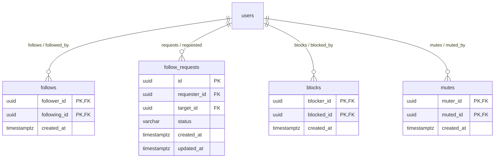

# Architecture: Social Graph, Follow Requests & Moderation

## 1. System Overview
The Social Graph module models relationships between users: Following, Followers, Mutual Connections, Follow Requests (for private accounts), Blocks, and Mutes.

## 2. Entity Relationship Diagram (ERD)



## 3. Mutual Connections Computation
Mutual connections between viewer $V$ and target $T$ are accounts $X$ such that:
$$X \in \text{Follows}(V) \cap \text{Follows}(T)$$
In SQL:
```sql
SELECT u.id, u.username, p.display_name, p.avatar_url
FROM follows f_viewer
JOIN follows f_target ON f_viewer.following_id = f_target.following_id
JOIN users u ON u.id = f_viewer.following_id
JOIN user_profiles p ON p.user_id = u.id
WHERE f_viewer.follower_id = $1 AND f_target.follower_id = $2
LIMIT 5;
```
Cached in Redis at `mutuals:v:{viewer_id}:t:{target_id}` for 15 minutes.

## 4. Hard Block vs. Soft Mute Invariant Enforcement
1. **Block Rule:** If $A$ blocks $B$:
   - Any existing follow from $A \to B$ or $B \to A$ is immediately deleted.
   - $B$ cannot view $A$'s profile, posts, or replies.
   - $B$ cannot send DMs to $A$.
   - $B$'s posts are completely excluded from $A$'s timeline and search.
2. **Mute Rule:** If $A$ mutes $B$:
   - Follow relationship remains intact.
   - $B$ is completely unaware of the mute.
   - $B$'s posts and interactions are silenced from $A$'s home feed and notifications.
