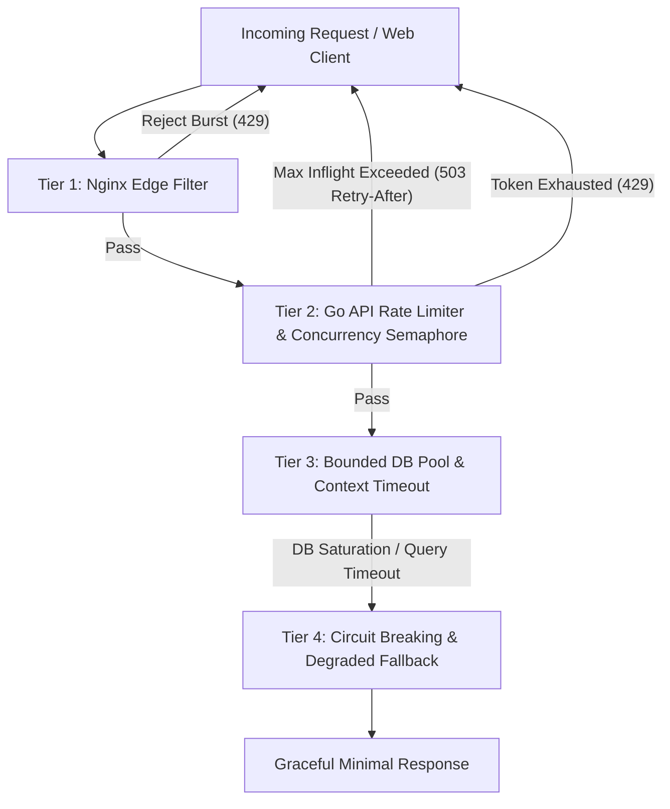

# Traffic Spike Protection & Resiliency Architecture

This document specifies the multi-tier traffic spike protection, admission control, backpressure, and graceful degradation strategies designed to keep the X-like platform responsive and immune to memory exhaustion on a 4 GB RAM VPS.

---

## 1. Multi-Tier Defense Overview

Under sudden traffic surges (e.g. breaking viral post, notification fan-out, coordinated bot sweep, or load testing), servers typically fail due to unbound goroutines, connection exhaustion, and OOM kills. We implement a **4-tier layered defense**:

---

## 2. Tier 1: Nginx Edge Shielding

The reverse proxy (`x-proxy`) is the first line of defense. By dropping abusive traffic before it reaches Go or Node.js runtime, we prevent memory allocation entirely.

### Rate Limiting Zones (`deploy/nginx/nginx.conf`)
- **API Request Limit**: 30 requests/second per IP with burst=50 and `nodelay`.
- **Search & Recommendation Limit**: 10 requests/second per IP with burst=15 (expensive operations).
- **Authentication Limit**: 5 requests/minute for login/register to prevent credential stuffing.
- **WebSocket Connection Limit**: 10 connections per IP.

### Request Body & Timeout Constraints
- `client_max_body_size 10M;` (strictly rejected before buffering into backend memory).
- `client_body_buffer_size 128k;` (spills to disk if exceeded rather than taking RAM).
- `client_header_timeout 10s;` (guards against Slowloris attacks).
- `client_body_timeout 10s;`
- `proxy_connect_timeout 5s;`
- `proxy_read_timeout 15s;` (prevents hung backend connections from holding proxy buffers).

---

## 3. Tier 2: Go API Admission Control & Backpressure

### 3.1 Bounded Concurrency Semaphore (`internal/middleware/concurrency.go`)
To prevent unbound goroutine proliferation when downstream services (PostgreSQL/Redis) slow down, an admission control semaphore limits concurrent in-flight requests:
- **Global Concurrency Ceiling**: 300 concurrent requests across the entire API process.
- **Search / Expensive Routes Sub-Ceiling**: 50 concurrent requests.
- **Behavior on Saturation**:
  - Immediately rejects surplus requests with **HTTP 503 Service Unavailable**.
  - Includes standard headers: `Retry-After: 3` and `X-Backpressure: Active`.
  - Prevents queueing memory overhead inside the Go runtime.

### 3.2 Sliding Window Rate Limiter with Redis Fallback
Rate limiting is evaluated against authenticated `User-ID` first; unauthenticated requests fall back to client IP:
- Reads/Timeline: 120 req/min.
- Post Creation / Actions: 30 req/min.
- Search Queries: 20 req/min.
- Responses return standard headers:
  - `X-RateLimit-Limit: 120`
  - `X-RateLimit-Remaining: 119`
  - `X-RateLimit-Reset: 1697380000`
  - On violation: **HTTP 429 Too Many Requests** with `Retry-After: 60`.

### 3.3 Context Deadlines & Request Cancellation
Every HTTP handler inherits `r.Context()` with strict deadlines:
- Standard REST Endpoints: 3,000 ms timeout.
- Search Endpoints: 2,500 ms timeout.
- File Uploads: 15,000 ms timeout.
- If the client disconnects prematurely, Go context cancellation terminates the database query immediately via `pgx`/`database/sql` driver cancellation, saving database CPU.

---

## 4. Tier 3: PostgreSQL Connection Pool Protection

Connection leaks and oversized pools are the #1 cause of sudden database crash on 4GB VPS.
- **Maximum Open Connections**: 20 per API container.
- **Maximum Idle Connections**: 10.
- **Connection Max Lifetime**: 15 minutes.
- **Connection Max Idle Time**: 3 minutes.
- **Statement Timeout**: Set globally in Postgres to `3000ms` (`SET statement_timeout = '3s';`). Any query exceeding 3s is aborted by Postgres kernel before causing I/O thrashing.

---

## 5. Tier 4: Graceful Degradation & Priority Shedding

When system resources are constrained (CPU > 85%, RAM available < 500 MB), the platform sheds non-essential work according to strict prioritization:

| Tier | Component / Feature | Degraded Behavior Under High Load |
|---|---|---|
| **P0 (Critical)** | Auth & Session Verification | Always operational. Never bypassed or cached insecurely. |
| **P0 (Critical)** | Core Post Creation & Direct Messaging | Standard processing; durable write to Postgres. |
| **P1 (Core)** | For You & Following Feeds | If candidate ranking pipeline times out (>500ms), fallback to simple indexed chronological timeline from Redis or DB. |
| **P2 (Secondary)** | Full-Text Search | Limit candidates from 200 to 30. Truncate query terms if parsing takes >1s. |
| **P3 (Deferred)** | Outbox Worker & Analytics | Rate of event publishing throttles down; notifications enqueue into durable RabbitMQ without immediate push. |
| **P4 (Sheddable)** | Rich Link Previews & Trending Computation | Silently skipped or served from stale 1-hour cache. |

---

## 6. Retry Storm Prevention

Client-side retry storms amplify minor slowdowns into catastrophic outages. The system enforces:
1. **Exponential Backoff with Full Jitter**:
   - `sleep = random(0, min(max_backoff, base_backoff * 2^attempt))`
2. **Never Retry Non-Idempotent / Permanent Errors**:
   - HTTP 400, 401, 403, 404, 422 are never retried.
3. **Respect `Retry-After`**:
   - The frontend API client interceptor checks for `Retry-After` on 429 and 503 responses and delays retries accordingly.
4. **Client-Side Throttling**:
   - Maximum 3 retry attempts before surfacing an inline error message to the user.
