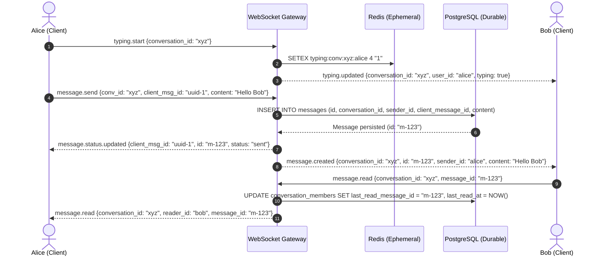

# REA Investigation: X/Twitter Realtime Direct Messaging (DM)

## 1. Executive Summary
This document outlines the reverse engineering findings regarding X's Direct Messaging (DM) architecture, conversation lists, message delivery lifecycle, typing indicators, read receipts, and realtime connection semantics.

---

## 2. REA Evidentiary Matrix

| DM Flow | Classification | Observed Behavior / Architectural Reality | Proposed Independent Implementation |
|---|---|---|---|
| **Conversation List** | **VERIFIED** | Left pane on `/messages`. Shows user avatar, display name, handle, snippet of last message, timestamp relative format (`3h`, `Oct 12`), and blue dot unread badge. | `conversations` and `conversation_members` with cursor-based pagination and joined last message preview. |
| **Direct 1-on-1 Creation** | **VERIFIED** | Clicking "New message" icon or "Envelope" on profile opens conversation. If conversation between two users already exists, resumes existing thread rather than creating a duplicate. | Deterministic conversation lookup: query `conversation_members` where count = 2 and members match user pair. |
| **Message Composition & Drafts** | **VERIFIED** | Text input with auto-expanding textarea, emoji picker, media attachment icon (images/GIFs). Enter sends message (or Shift+Enter for newline). | Client-side text area with image upload pipeline and client-generated `client_message_id` for idempotency. |
| **Optimistic Sending State** | **VERIFIED** | Message bubble appears instantly with lower opacity or subtle sending spinner. Upon server confirmation, transitions to solid sent bubble. | Client displays message immediately with state `sending`; updates to `sent` upon receiving WebSocket ACK or HTTP 201 response. |
| **Typing Indicator** | **VERIFIED** | Shows pulsing three-dots animation `... @username is typing` when peer types. Disappears after 3-5 seconds of inactivity or upon message arrival. | Ephemeral state stored exclusively in Redis with key `typing:conversation:{id}:user:{id}` with 4-second TTL. Broadcast via WebSocket. |
| **Delivery & Read Receipts** | **VERIFIED** | Displays checkmark or "Seen" timestamp. Conversation in sidebar loses unread badge once opened. | `conversation_read_states` tracks `last_read_message_id` and `last_read_at`. Emits `message.read` WebSocket event to peer. |
| **Media Attachments** | **VERIFIED** | Image thumbnails displayed inline in message bubble with rounded corners and click-to-enlarge modal. | Uploaded through `/api/v1/media/upload`, compressed and stored in Cloudflare R2, referenced by `media_id` in message. |
| **Realtime Connection Transport** | **INFERRED** | Realtime stream over WebSocket/HTTP2 server-sent events for live message delivery; falls back to polling if connection drops. | Full-duplex WebSocket gateway (`/api/v1/ws`) with token authentication, ping-pong heartbeat, and client auto-reconnect with exponential backoff. |
| **Internal Transport Infrastructure** | **UNKNOWN** | X's internal DM brokers (historically Finagle/Netty pipelines with custom push engines). | Go WebSocket Hub + Redis Pub/Sub multi-node broadcast + PostgreSQL durable persistence. |

---

## 3. Realtime Lifecycle & Failure Recovery

---

## 4. Acceptance Criteria
1. DMs between blocked users must be completely prevented with 403 Forbidden.
2. Messages sent with identical `client_message_id` within 60 seconds must be deduped (idempotency).
3. If peer is offline, message remains stored durably in PostgreSQL and arrives immediately upon login/reconnect.
4. Typing indicators must never be persisted to PostgreSQL; strictly ephemeral in Redis with 4-second TTL.
5. Message history pagination must use cursor (`created_at`, `id`) rather than numerical offset.
