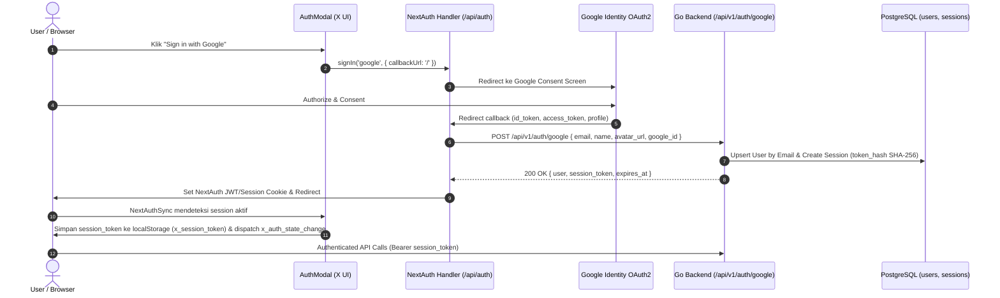

# REA Investigation: Google OAuth & Authentication Modal Architecture (X Standard)

## 1. Executive Summary & Objective
Analisis Reverse Engineering (REA) terhadap implementasi otentikasi X (sebelumnya Twitter) berfokus pada:
1. **User Experience (UX) & Design Token X**: Alur "Sign in with Google" / "Sign up with Google" pada modal login/register.
2. **Security & Session Management**: Pertukaran token OAuth Google menjadi stateful session token backend (Go API) dengan hashing SHA-256 dan cookie HttpOnly.
3. **Bridge Architecture**: Sinkronisasi seamless antara NextAuth v4 (Next.js 14 App Router) dan microservice Go REST API.

---

## 2. X (Twitter) Authentication Flow & UI Findings

### 2.1 Modal Layout & Visual Hierarchy
Pada `x.com/login` atau modal interaksi (Guest state):
- **Backdrop**: Semi-transparent black (`rgba(91, 112, 131, 0.4)` atau `rgba(0, 0, 0, 0.8)` di dark mode).
- **Dialog Box**: Rounded corners `rounded-2xl` (16px), background `#000000` (Pure Black / OLED), border tipis `#2f3336`.
- **Branding Header**: Logo X svg di bagian atas (`w-8 h-8`), tombol close silang (`✕`) di pojok kiri atas.
- **Header Typography**: 
  - Title: "Join X today" / "Sign in to X" (Font size 31px, font-weight 700 / Bold, color `#e7e9ea`).
- **Primary CTA Buttons**:
  - **Google OAuth Button**:
    - Style: Pill button (`rounded-full`), height `42px` (standard), width 100% (max 300px centered).
    - Background: `#ffffff` (White), hover `#e6e6e6` (Neutral 200).
    - Typography: Text color `#0f1419` (Dark), font-size 15px, font-weight 600.
    - Icon: Official Google multi-colored 'G' SVG icon di sisi kiri.
    - Text: "Sign up with Google" atau "Sign in with Google".
  - **Divider**:
    - Two subtle horizontal lines (`border-neutral-800` / `#2f3336`) with centered text: `or` (lowercase/uppercase, muted color `#71767b`).
  - **Fallback / Secondary CTA**:
    - "Create account" / "Sign in with email/username" (Pill button, bg blue/white).

---

## 3. Architecture & Token Synchronization Flow

---

## 4. Implementation Details

### 4.1 Backend (Go API)
- **Endpoint**: `POST /api/v1/auth/google`
- **Controller**: `GoogleAuth(w http.ResponseWriter, r *http.Request)` di `services/api/internal/handler/handler.go`
- **Features**:
  - Validasi email & sanitize username dari prefix email / nama Google.
  - Penanganan collision username otomatis (`username + suffix random 4 digit`).
  - Set avatar default dari Google profile picture jika user baru atau belum memiliki avatar.
  - Pembuatan session token via SHA-256 crypto random token, tersimpan di database table `sessions`.
  - Mengembalikan objek user lengkap beserta `session_token`.
  - Set cookie `x_session_token` dengan `HttpOnly`, `Path=/`, `SameSite=Lax`.

### 4.2 Frontend (Next.js 14 App Router & NextAuth)
- **Library**: `next-auth@^4.24.11`
- **Config**: `apps/web/src/lib/auth.ts`
  - Client ID & Secret diambil dari environment `.env`:
    - `GOOGLE_CLIENT_ID`
    - `GOOGLE_CLIENT_SECRET`
    - `NEXTAUTH_SECRET`
  - Seamless URL fallback untuk integrasi internal Docker network (`http://api:8080/api/v1`) maupun localhost direct access (`http://localhost:8080/api/v1`).
- **Sync Component**: `NextAuthSync` di `apps/web/src/components/providers/AppProviders.tsx`
  - Menyinkronkan session token NextAuth ke `localStorage` (`x_session_token`).
  - Mengirim custom DOM event `x_auth_state_change` agar seluruh komponen (Navbar, Feed, Profile, Composer) langsung sinkron tanpa perlu refresh halaman penuh.
- **Standard UI Modal**: `apps/web/src/components/auth/AuthModal.tsx`
  - Menyediakan tombol Google pill dengan standard SVG Google, loading state spinner, dan animasi transisi halus.

---

## 5. Verification & Testing Checklist
- [x] Backend endpoint unit test: `services/api/internal/handler/handler_test.go`
- [x] Route registration: `services/api/cmd/server/main.go`
- [x] NextAuth route handler: `apps/web/src/app/api/auth/[...nextauth]/route.ts`
- [x] Frontend build & type check: `npm run build`
- [x] Docker compose deployment sync: `docker compose up -d --build api web`
- [x] Dual-session synchronization (NextAuth session <-> Go backend Bearer token)
