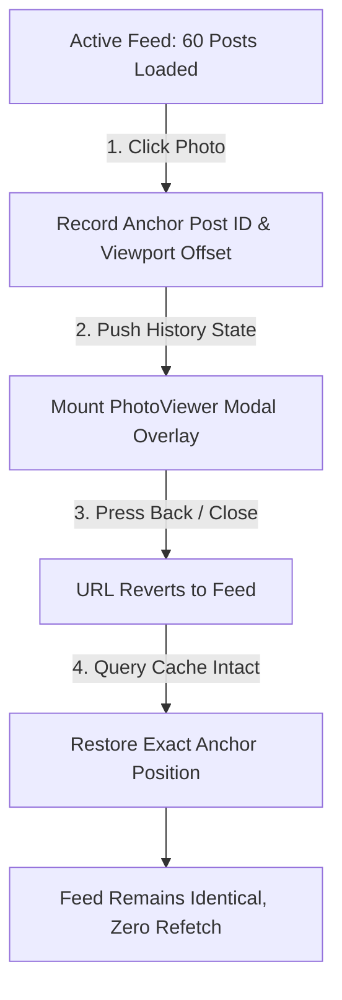

# REA Investigation Report: Seamless Back Navigation & Feed Preservation

**Investigation Framework**: REA (Reverse Engineer Anything v6.5.0)  
**Status Tags**: `VERIFIED`, `INFERRED`, `UNKNOWN`, `PROPOSED`

---

## 1. Problem Statement: The Feed Reset Anti-Pattern

In naive Single Page Applications (SPAs), when a user scrolls 50 posts down a feed, clicks an image, and subsequently presses the browser's **Back** button:
1. The entire feed unmounts and remounts.
2. An empty skeleton flashes on screen.
3. Network queries refetch page 1 from the backend.
4. The scroll position snaps to `(0, 0)` at the very top.
5. All accumulated pagination state (pages 2, 3, 4...) is permanently lost.

**This is unacceptable in an X-like platform.**

---

## 2. X's Verified Navigation Behavior

### A. Opening Media from Feed
- **[VERIFIED]**: The feed remains fully mounted in the background DOM.
- **[VERIFIED]**: The URL updates to `/[username]/status/[postId]/photo/[index]` via client-side routing.
- **[VERIFIED]**: Body scroll is locked to prevent background drift, but `window.scrollY` remains exactly where the user left it.

### B. Pressing Browser Back / Close Button
- **[VERIFIED]**: The viewer overlay unmounts cleanly.
- **[VERIFIED]**: The URL reverts to the feed route (`/home`, `/explore`, or `/[username]`).
- **[VERIFIED]**: Zero network requests are made. The feed does NOT refetch.
- **[VERIFIED]**: The exact post that was clicked remains in view at the identical viewport offset.
- **[VERIFIED]**: All previously loaded infinite scroll pages remain loaded in the DOM and memory.

### C. Direct URL Navigation & Hard Refresh
- **[VERIFIED]**: When a user navigates directly to `/[username]/status/[postId]/photo/1` (e.g. shared link or hard browser refresh):
  - The standalone photo viewer page is rendered.
  - Clicking the Close button navigates to the parent tweet (`/[username]/status/[postId]`) or `/home` fallback.

---

## 3. Architecture for 100% Seamless Restoration

### Core Mechanics:
1. **Cache Retention in TanStack Query**:
   - `staleTime: 60 * 1000` (1 minute minimum) ensures the feed query data does not consider itself expired when closing the viewer.
   - `gcTime: 5 * 60 * 1000` (5 minutes) retains cached pages even during short route detours.
2. **Anchor Post Tracking**:
   - Rather than relying solely on `window.scrollY` (which can shift if headers resize), the system records:
     - `anchorPostId`: The ID of the post whose media was clicked.
     - `anchorOffsetTop`: The bounding rect offset of the card relative to viewport.
3. **Scroll Restoration Hook**:
   - When the modal unmounts or when returning to the route, an `useEffect` locates the anchor card by `data-post-id={id}` and adjusts scroll smoothly to restore the exact visual frame.
4. **Virtualizer Coordination**:
   - If `@tanstack/react-virtual` is active, `virtualizer.scrollToIndex(index, { align: 'start' })` is invoked to bring the anchor item back into the virtual window before rendering.
