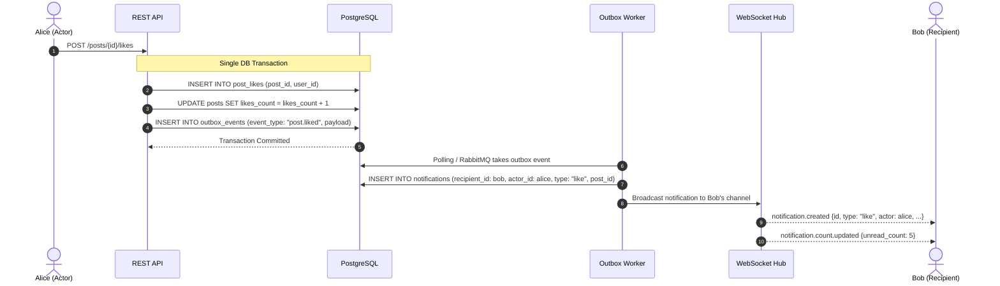

# REA Investigation: X/Twitter Realtime Notification System

## 1. Executive Summary
This document investigates and defines the behavior of X's notification system, covering in-app notification inbox tabs, badge count increments, realtime fanout, delivery guarantees, and transactional outbox persistence.

---

## 2. REA Evidentiary Matrix

| Notification Flow | Classification | Observed Behavior / Architectural Reality | Proposed Independent Implementation |
|---|---|---|---|
| **Notification Inbox Tabs** | **VERIFIED** | Tabs: **All**, **Verified** (only verified accounts), and **Mentions** (replies and user tags `@username`). | Query filtering on `notifications` table joining `users.is_verified` or matching `type IN ('mention', 'reply')`. |
| **Notification Categories** | **VERIFIED** | Follow, Like, Repost, Reply, Mention, DM message, and System/Subscription updates. Displays actor avatar, action icon (heart, repost, user, checkmark), snippet, and timestamp. | Enumerated notification types: `follow`, `follow_request`, `like`, `repost`, `reply`, `mention`, `dm`, `verified`. |
| **Unread Badge Count** | **VERIFIED** | Number badge (e.g. `1`, `9+`) on sidebar "Notifications" icon. Updates immediately when user receives an interaction. Clears or decrements upon viewing. | Calculated via `COUNT(*)` where `recipient_id = $1 AND is_read = FALSE` with Redis key `unread:user:{id}` cache. Broadcast via `notification.count.updated`. |
| **Mark as Read** | **VERIFIED** | Navigating to `/notifications` or clicking individual item marks it as read. "Mark all as read" button available. | `POST /api/v1/notifications/{id}/read` and `POST /api/v1/notifications/read-all`. Clears Redis unread cache. |
| **Grouping / Deduplication** | **VERIFIED** | Multiple likes on the same post are collapsed: *"Alice and 3 others liked your post"*. | Deduplication key: `like:{post_id}` or `repost:{post_id}`. Collapsed dynamically or aggregated within sliding 24-hour window. |
| **Transactional Outbox Event Fanout** | **INFERRED** | User interactions (liking a post, following) commit atomically with domain tables, then an asynchronous background worker handles notification creation and push. | `outbox_events` table written in the same SQL transaction as domain actions. Dedicated worker reads outbox and emits WebSocket & DB records. |
| **Internal Notification Queue** | **UNKNOWN** | X's internal push pipelines (Kafka partitions, custom push service). | PostgreSQL Outbox + RabbitMQ/Worker queue + Redis Pub/Sub + WebSocket hub. |

---

## 3. Notification Fanout Flow

---

## 4. Acceptance Criteria
1. Liking or following one's own account must never trigger a self-notification.
2. Notifications must persist durably in PostgreSQL before WebSocket broadcast.
3. Offline users must receive all pending notifications when reconnecting.
4. Muted and blocked users must not generate notifications for the blocker/muter.
5. "Mark all as read" must atomically update all unread notifications for the user.
