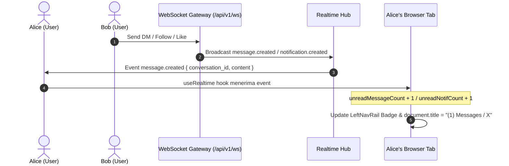

# REA Investigation & Architecture: Realtime Badges, Tab Count, Messages Flow & Social Graph

## 1. Executive Summary & Objective
Analisis Reverse Engineering (REA) ini berfokus pada:
1. **Realtime Multi-Counter & Document Title Synchronization (X Standard)**:
   - Pelacakan jumlah unread notifications dan unread messages secara simultan.
   - Sinkronisasi dinamis pada tab browser: `(N) X` atau `(N) Messages / X` ketika terdapat notifikasi atau pesan baru via WebSocket gateway.
   - Tampilan badge counter pill pada Left Navigation Rail (ikon Notifikasi dan Pesan).
2. **Root-Cause Analysis: Kegagalan Pencarian User & Pembukaan Kolom Obrolan di `/messages`**:
   - Analisis mendalam terhadap bug database scanning Go SQL di PostgreSQL: `converting NULL to string is unsupported` pada field `c.name` di tabel `conversations`.
   - Mengapa obrolan 1-on-1 (yang memiliki `name = NULL`) menyebabkan endpoint `GET /conversations` dan `GET /conversations/{id}` gagal dan mengembalikan array kosong.
   - Pemulihan alur pembuatan/pemilihan obrolan langsung (`startConversationWith`) dan handling responsive kolom obrolan (mobile vs desktop).
3. **Followers & Following Page Architecture (`/[username]/followers` & `/[username]/following`)**:
   - Pembuatan rute Next.js untuk daftar pengikut dan yang diikuti dengan desain standar X (sticky header, navigation tabs, user list card, dan tombol hover Follow/Unfollow).

---

## 2. Root-Cause Analysis: Messages Flow Bug

### 2.1 The Invisible Database Null Scan Error
Pada tabel `conversations`, obrolan personal (Direct Messages 1-on-1) memiliki kolom `name = NULL` (hanya group chat yang memiliki nama).
Pada `services/api/internal/repository/postgres.go`:
```go
// SEBELUM PERBAIKAN:
query := `
    SELECT c.id, c.is_group, c.name, c.created_at, c.updated_at, ...
`
// rows.Scan(&c.ID, &c.IsGroup, &c.Name, ...)
```
Karena field `c.Name` bertipe Go `string` (bukan pointer `*string` atau `sql.NullString`), runtime Go `database/sql` menghasilkan error fatal:
`sql: Scan error on column index 2, name "name": converting NULL to string is unsupported`

Pada handler `GetConversations`:
```go
convs, err := h.repo.GetConversations(r.Context(), user.ID, 30, "")
if err != nil {
    convs = []domain.Conversation{} // Error ditelan dan mengembalikan []
}
```
Akibatnya:
- `POST /conversations` berhasil membuat obrolan di PostgreSQL.
- Namun saat frontend memuat obrolan dengan `GET /conversations`, API selalu mengembalikan `[]`.
- Ketika user mencari target user dan mengklik hasil pencarian, sistem tidak dapat menemukan detail obrolan, kolom obrolan kanan tetap menampilkan *"Select a message"*, dan pesan *"No messages yet"* tetap tampil di sebelah kiri.

### 2.2 Solusi REA
Menerapkan `COALESCE(c.name, '')` pada query `GetConversations`, `GetOrCreateConversation`, dan `GetConversationByID` di `postgres.go`, sehingga nilai `NULL` secara otomatis diubah menjadi empty string `""` yang valid untuk Go `string`.

---

## 3. Realtime Tab & Document Title Architecture



### 3.1 Document Title Format
Sesuai standar X/Twitter:
- Jika total unread (`unreadNotifCount + unreadMessageCount`) > 0:
  `document.title = "(${totalUnread}) ${cleanTitle || 'X'}"`
- Jika semua telah dibaca (0 unread):
  `document.title = cleanTitle || 'X'`

---

## 4. Followers & Following Pages
Dibangun pada:
1. `apps/web/src/app/[username]/followers/page.tsx`
2. `apps/web/src/app/[username]/following/page.tsx`

Fitur yang diimplementasikan:
- Header Sticky dengan tombol panah kembali (`ArrowLeft`), Display Name, Verified Badge, dan Handle `@username`.
- Standard X Tabs: "Followers" dan "Following" dengan indicator garis bawah biru (`bg-brand`).
- List kartu user dengan avatar, nama lengkap, handle, bio, dan tombol `Follow`/`Following` (hover `Unfollow` dengan warna merah).
- Optimistic update untuk follow/unfollow secara instan.
