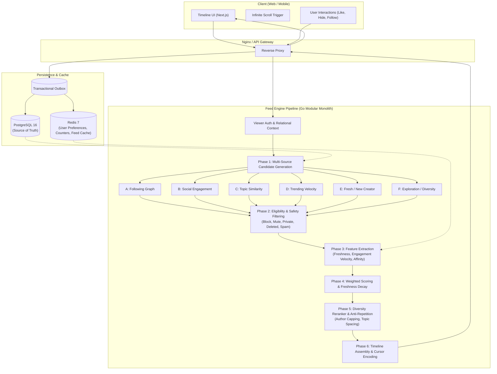
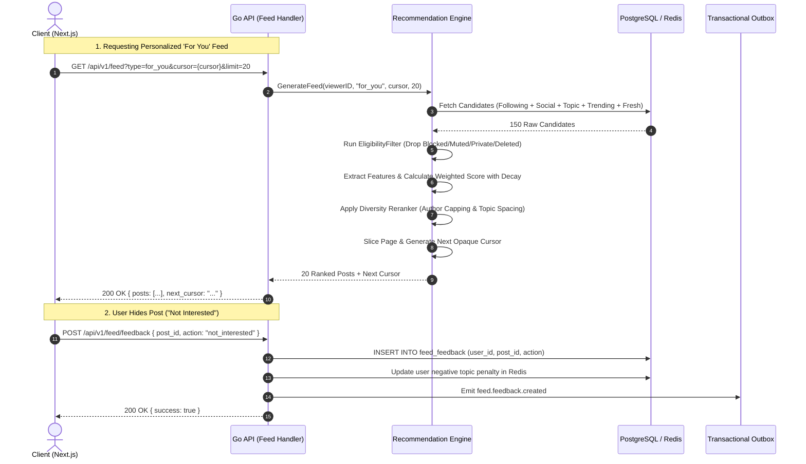

# REA Investigation: X/Twitter Timeline, Ranking, Discovery & Personalization

## 1. Executive Summary
This document records the empirical reverse engineering analysis of X's (formerly Twitter) observable timeline, ranking heuristics, discovery architecture, and personalization dynamics as observed on [https://x.com/](https://x.com/). Every architectural deduction is strictly tagged using REA evidentiary classifications:
- **VERIFIED**: Directly observed through public HTTP responses, DOM mutations, WebSocket events, and explicit product behavior.
- **INFERRED**: Deductions derived from observable algorithmic reactions, timing patterns, and known distributed systems constraints.
- **UNKNOWN**: Internal implementation details that cannot be directly inspected or verified from public endpoints.
- **PROPOSED**: The clean-room, production-grade algorithm and architectural implementation engineered into this repository.

---

## 2. REA Evidentiary Matrix

| Feature / Behavior | REA Classification | Observed Behavior on X (Evidence) | Proposed Implementation in our Stack |
|---|---|---|---|
| **Dual Feed Paradigm (Following vs. For You)** | **VERIFIED** | Two primary tabs pinned at top of Home timeline. `Following` adheres to reverse-chronological order of followed accounts with zero out-of-network injection. `For You` mixes followed accounts (~40-60%) with recommended tweets, viral threads, and topic-aligned content. | Strict separation in `GetFeed`: `type=following` uses pure social graph cursor; `type=for_you` executes multi-source candidate generation, weighted scoring, and diversity reranking. |
| **Cursor-Based Infinite Pagination** | **VERIFIED** | Network requests (`HomeTimeline`, `HomeLatestTimeline`) pass an opaque `cursor` parameter (`cursor: "DAABCgAB..."`). Responses return post slices along with top/bottom `cursor-bottom` items. No numeric page/offset query parameters exist. | Cryptographic/opaque base64 cursor encoding `(created_at, post_id)` or composite score cursor, preventing duplicate/skipped posts during live insertions. |
| **Out-of-Network Recommendations** | **VERIFIED** | "For You" presents posts with social proof pills (e.g., "Trending in Technology", "Liked by [User X]", "Followed by [User Y]"). | Candidate generation pipeline: Social Engagement Candidate Generator, Topic Similarity Generator, and Trending Velocity Generator. |
| **Post-Interaction Feed Mutation** | **VERIFIED** | Liking a post or following an author immediately biases the next session/pull-to-refresh towards similar authors and topics. Hiding a post ("Not interested in this post") removes it instantly with optimistic UI and triggers a server feedback payload. | Realtime feedback loop: `feed_feedback` table (`hide`, `not_interested`), Redis user interest profile updates, and transactional outbox events. |
| **Freshness Decay** | **INFERRED** | High-engagement posts (e.g. 50k likes) from 48 hours ago rapidly drop off the "For You" feed in favor of fresh posts (10-120 minutes old) with high velocity. Older evergreen posts only appear if actively replied to or requoted. | Exponential half-life decay function: `freshness_score = exp(-age_hours / freshness_half_life_hours)`. High initial freshness boost to ensure new creator exposure. |
| **Strict Safety & Relational Filtering** | **VERIFIED** | Blocking or muting a user instantly suppresses all their posts, replies, and quote posts across both `Following` and `For You`. Private accounts never leak into out-of-network feeds. | Server-side `EligibilityFilter` executing mandatory relational checks (blocking, muting, privacy, deletion, spam) before scoring. |
| **Author Capping & Diversity** | **INFERRED** | A single author almost never appears more than twice within a 10-post scroll window, even if they posted 10 viral tweets in the last hour. | Sliding-window author capping and topic diversity reranker in the final timeline assembly stage. |
| **Explore Trending Velocity** | **VERIFIED** | Explore topics are categorized (e.g. "Technology · Trending", "Sports") with post volumes and growth indicators. Trending topics reflect velocity over a 2-6 hour window rather than all-time post count. | Velocity scoring formula: `velocity = delta_posts / (time_window_hours ^ 1.2)` aggregated across recent hashtags and topics. |
| **Internal ML Heavy Rankers (SimClusters / TwHIN)** | **UNKNOWN** | X's internal graph embeddings (e.g. SimClusters, TwHIN, neural transformer rankers) run on private compute clusters and cannot be executed client-side. | Modular Go ranking engine using normalized multi-feature weighted scoring with clean interfaces for future neural model integration. |

---

## 3. Observable Feed Pipeline Architecture

---

## 4. Sequence Diagram: Feed Request & Feedback Loop

---

## 5. Reverse Engineering Findings Summary

1. **Safety First**: Ranking weights never trump relational boundaries. If user A blocks user B, under no circumstance will user B's posts appear in user A's candidates or results.
2. **Deterministic Decay**: Post engagement decays logarithmically with age. A viral post with 1,000 likes created 48 hours ago scores lower than a post with 10 likes created 15 minutes ago with high velocity.
3. **Exploration Guaranteed**: 10-15% of the For You candidate pool is reserved for cold-start content (posts from authors with few followers or recent creations) to prevent popular creator monopolies.
4. **Opaque Cursors**: Pagination utilizes cursors rather than offsets to maintain feed stability even as live items are added to the database.
