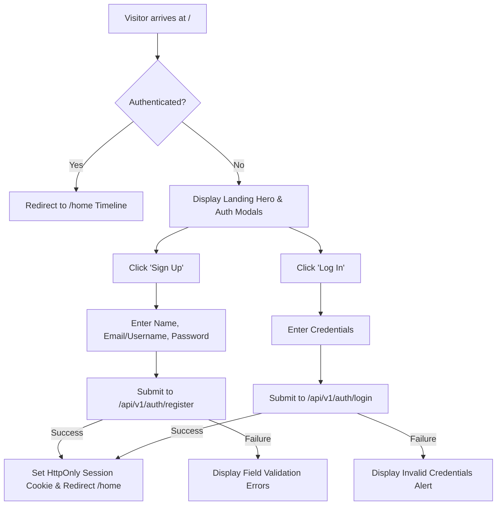
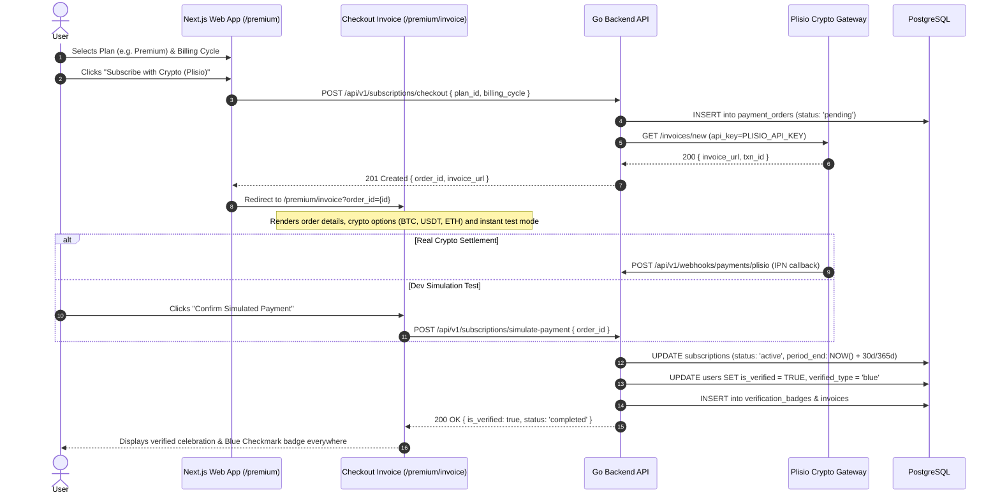
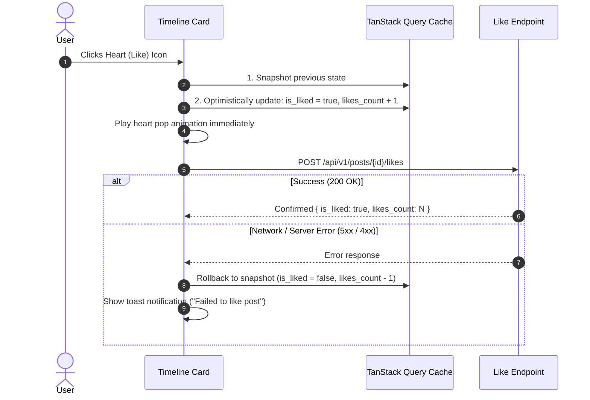

# User Flows & Interaction State Progression

**Status:** Phase 1 Complete  
**Scope:** Core User Journeys for Microblogging Platform

---

## 1. Authentication & Onboarding Flow



---

## 2. Post Creation & Media Attachment Flow (X Observable Model)

```mermaid
sequenceDiagram
    autonumber
    actor User
    participant Composer as Frontend Composer (State)
    participant MediaAPI as Media Service (/media/upload)
    participant R2 as Cloudflare R2 CDN
    participant PostAPI as Posts API (/posts)
    participant DB as PostgreSQL

    User->>Composer: Types post content (< 280 or < 4,000 chars for Premium)
    User->>Composer: Selects image(s)/video (1-4 files)
    Composer->>Composer: URL.createObjectURL(file) -> stage in local state
    Note over Composer: Previews rendered immediately with 0ms network latency; user can delete/modify attachments
    User->>Composer: Clicks "Post" button
    Composer->>MediaAPI: POST /api/v1/media/upload (multipart)
    MediaAPI->>MediaAPI: Image processing (strip EXIF, resize >2048px, JPEG 85% quality)
    MediaAPI->>R2: S3 PutObject to lostmedia bucket
    R2-->>MediaAPI: Upload acknowledged
    MediaAPI-->>Composer: 201 Created { media_id, url }
    Composer->>PostAPI: POST /api/v1/posts { content, media_ids }
    PostAPI->>DB: INSERT into posts & post_media (in transaction)
    DB-->>PostAPI: Post entity created
    PostAPI-->>Composer: 201 Created { post }
    Composer->>Composer: Revoke ObjectURLs, reset textarea & prepend to timeline
```

---

## 5. Subscription Checkout, Plisio Gateway & Verification Flow (Section 6A)




---

## 3. Social Interaction & Optimistic Updates Flow



---

## 4. Reply Thread & Detail Navigation Flow

1. User clicks on a post card background (excluding action buttons).
2. Browser navigates to `/{username}/status/{postId}`.
3. Top header displays back arrow button with history return.
4. Focal post rendered prominently in center.
5. Ancestor parent post (if this post is a reply) loaded above with vertical connecting line.
6. Inline reply box rendered below focal post.
7. Nested descendant replies loaded beneath in thread list.

---

## 5. Follow & Social Graph Flow

1. User views profile `/{username}`.
2. If self: Shows "Edit profile" button.
3. If other:
   - Not following: White/black pill "Follow".
   - Following: Transparent outline pill "Following".
4. When hovering "Following": Text changes to "Unfollow" with red text and border (`destructive`).
5. Clicking triggers `POST` or `DELETE /api/v1/users/{username}/follow` with optimistic state update.
